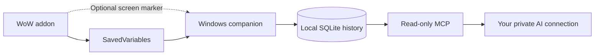

# WoW Character Intelligence

**Your character's quests, gear and inventory—available to your AI assistant with timestamps and evidence.**

[](https://github.com/bkhouser/WoW4EMCP/actions/workflows/ci.yml)
[](LICENSE)
[](docs/SETUP.md)
[](https://github.com/bkhouser/WoW4EMCP/releases)

[**Get started**](docs/SETUP.md) · [**Downloads**](https://github.com/bkhouser/WoW4EMCP/releases) · [**Sync controls**](docs/SYNC-MODES.md) · [**Connect ChatGPT**](docs/CHATGPT.md) · [**Documentation**](docs/README.md)

The release ZIP includes the WoW addon, Windows companion, read-only MCP server, and plugin configuration files (`plugin.json` and `mcp.json`). The server runs on your PC, where your character history is stored in SQLite. You can connect ChatGPT through your own private Secure MCP Tunnel or use another authorized MCP client.

## What you can ask

| Question | Evidence the tools return |
| --- | --- |
| “Which quests are taking up my quest slots?” | Active quest IDs, objective states, capacity and missing context; no invented abandonment advice |
| “Am I ready to finish this warlock quest?” | Observed objectives and item counts, with objective completion separate from turn-in |
| “How many Murloc Eyes do I have, and where?” | Counts and bag locations, with unopened or stale storage identified |
| “What should my next talent point be?” | Observed build, level and available points where exposed; unavailable values stay unknown |
| “What changed since my last session?” | Immutable observations with original timestamps, coverage and provenance |

**Completed objectives are not confirmed turn-ins. An unobserved bank is not an empty bank.** Those distinctions are part of the data model, not just prompting advice.

## Refresh without the busywork

A small circular book icon sits around the minimap:

| Action | Result |
| --- | --- |
| **Left-click** | Capture a fresh snapshot and reload the UI, outside combat |
| **Right-click** | Open sync settings |
| **Drag** | Move the icon around the minimap; position saves on reload/logout |
| **Gentle pulse** | A save is due; default reminder is 15 minutes, configurable |

Choose **reload**, **screen**, **both**, or **off**. **Reload-only is the default.** Experimental screen sync displays a compact data marker and requires explicit opt-in in both WoW and Windows. Its encoder/decoder is tested; live optical capture is not yet certified. See [how refresh works](docs/SYNC-MODES.md).



WoW writes SavedVariables on reload/logout, not continuously. The default companion checks saved files every 15 seconds. AI tools cannot trigger a reload, enable capture or automate gameplay.

## Start here

**Requirements:** Windows 11 x64, Node.js **24.14+ within the 24 series**, PowerShell, and your own WoW installation. ChatGPT connectivity additionally requires account access to custom MCP connections and Secure MCP Tunnel. No Battle.net password is needed.

### Try synthetic data first

```powershell
git clone https://github.com/bkhouser/WoW4EMCP.git
Set-Location WoW4EMCP
npm ci
npm test
npm run demo
node dist/src/cli.js show --config config.sample.json `
  --character forever:us:normal:sample-examplewarlock
```

This uses a separate sample database. Nothing in the examples is live character data.

### Capture your own character

Follow the [Windows setup guide](docs/SETUP.md), then [connect your private ChatGPT plugin](docs/CHATGPT.md). The guide covers installation, exact character authorization, first capture, startup, and verification. Existing users should read the [upgrade procedure](docs/OPERATIONS.md#upgrade-and-rollback) before replacing files.

## What is verified

| Area | Status |
| --- | --- |
| Forever quests, equipment, bags, allocated talents and progression | Captured on one Windows 11 installation |
| Minimap controls and one-click reload | Confirmed in the live Forever client |
| Private ChatGPT connection | Verified through real MCP tool calls |
| Screen transport | Automated Lua → decoder → SQLite tests; **live capture unverified** |
| Retail, Classic Era and Mists Classic | Separate identities supported; **live addon compatibility unverified** |
| Blizzard Forever APIs | OAuth/retry/cache/adapters tested with fixtures; **authenticated endpoints unverified** |
| Unattended reboot/reconnect | **Not certified** |

This is a public beta. [Coverage](docs/COVERAGE.md), [validation](docs/VALIDATION.md) and the [roadmap](docs/ROADMAP.md) distinguish implemented behavior from future work.

## Tools, privacy and development

There are **13 read-only tools** for character status, quests, storage, progression and history. See the [tool reference](docs/TOOL-REFERENCE.md) and [example calls](docs/EXAMPLES.md).

The public repository and release ZIPs contain source, empty configuration templates and synthetic fixtures. They contain no owner's captures, runtime credentials or private connection links. Each installation needs its own authorized sources and private connection. The optional HTTP listener requires authentication and binds only to loopback; public multi-user hosting is not implemented.

For contributors, start with [architecture](docs/ARCHITECTURE.md), [development and releases](docs/DEVELOPMENT.md), and the [code review record](docs/REVIEW.md). Windows CI runs tests, documentation/publication checks, secret scanning and package validation.

[Security reporting](SECURITY.md) · [Privacy and deletion](docs/SECURITY.md) · [Troubleshooting](docs/TROUBLESHOOTING.md) · [Contributing](CONTRIBUTING.md) · [Changelog](CHANGELOG.md) · [Third-party notices](THIRD_PARTY_NOTICES.md)

---

Unofficial community project; not affiliated with or endorsed by Blizzard Entertainment or OpenAI. World of Warcraft and other product names belong to their owners. The [MIT license](LICENSE) covers this project's original code, not game data, trademarks or third-party software.
