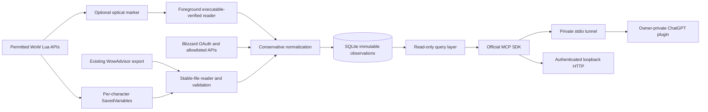

# Architecture and evidence rules

## Modules

`model.ts` defines Zod validation and typed domain payloads. `acquisition.ts` implements a non-executing SavedVariables string parser, strict JSON parser and stable byte comparison. `optical.ts` validates/reassembles bounded screen packets; the Windows helper decodes them before emitting packet bytes. `watch.ts` applies configuration revocation independently of file scans. `store.ts` owns SQLite transactions/history. `blizzard.ts` implements OAuth, pacing, retry/cache and endpoint normalization. `queries.ts` contains evidence operations. `mcp.ts` owns schema registration and transport. `cli.ts` is the local operator/synchronizer. `scripts/` contains Windows lifecycle and DPAPI helpers. The Companion Site is not a dependency.

Node 24 and the built-in SQLite module avoid native npm compilation and external services on the inspected machine. The official MCP TypeScript SDK provides stdio and Streamable HTTP. The dependency lock is part of the release. TypeScript strict mode is enabled. The addon is original Lua; third-party exporter code was not copied.

## Identity and storage

A character key is `gameVersion:region:scope:slug`, with each component lowercased and URI-encoded. Forever uses an explicitly configured ruleset; ordinary clients use realm scope. The addon and legacy exporter do not prove region/surname mapping, so this origin is documented rather than presented as observed. Config lists authorize acquisition; the MCP database contains only imported authorized characters. Sample and real SQLite stores enforce incompatible modes at open/import.

`snapshots` are immutable validated source captures, deduplicated by SHA-256, with a canonical comparison for older schema-1 bodies at the same character/source/capture time. A capture lookup index supports that compatibility path. `observations` retain individual domain payloads and coverage. New payloads are canonicalized through their domain schema before persistence; undeclared fields are dropped. Existing historical rows are not rewritten. `characters` contains canonical identities. `sync_status` records attempts/errors separately from game evidence. Import is one transaction, including its deduplication key. WAL and a busy timeout support concurrent collector/read-only MCP access. Schema version 1 is checked at ingestion; future schema migration requires explicit implementation.

## Time and conflicts

* `observedAt`: when game facts were actually inspected; nullable for API evidence without a reliable observation timestamp.
* `capturedAt`: when the exporter packaged the snapshot.
* `syncedAt`: first successful insertion into the local database.
* `transport`: optional `savedvariables` or `optical` acquisition route. Identical evidence arriving by both routes keeps both history receipts but appears once in the current query view.
* `freshness`: evaluated at query time using a configurable 15-minute default. Re-reading/re-importing old bytes never refreshes game evidence.

Selection prefers an actual payload, a known observation timestamp and direct evidence. For inventory and equipment, complete enumeration takes precedence over partial scans; within those priorities, the newest observation wins, then addon > legacy exporter > Blizzard authority on ties. Payload order makes equal-time contradictory selection deterministic; the conflict remains visible. Untimed API data cannot replace dated addon evidence merely because HTTP was fetched later. Earlier fully observed storage retains its old timestamp after a partial or unobserved scan. Partial and complete scopes are not silently unioned. Alternatives remain visible and can be retrieved by observation ID.

## Coverage contract

| Value | Meaning |
| --- | --- |
| `observed` | The stated collection scope was enumerated; nullable individual fields can still be unknown |
| `partial` | Some facts were observed, but completeness is not established |
| `not_observed` | This source/session has not inspected the scope |
| `unavailable` | A required API/read failed or is unsupported |
| `unknown` | Available evidence cannot establish the status |

`[]` or `0` is confirmed only inside an appropriately observed scope. Legacy bag omission is never zero. Bank facts have independent observation time and open/closed state; a closed bank is not a freshly observed bank. Per-profession scans retain their own times and truncation. Every tool response is bounded to 200 KB; lists use at most 100 rows per page. Historical detail searches are explicitly bounded.

## Quest invariants

Quest ID, objective text/counts, objective completion, current-log presence and historical disposition are distinct. `QUEST_TURNED_IN` is explicit event evidence; `GetAllCompletedQuestIDs` is a completion flag without an occurrence or timestamp. `QUEST_REMOVED` has unknown cause. No disappearance becomes abandonment or completion. The current occurrence is never marked turned in from a historical event with the same repeatable quest ID. The release does not guess hidden chains or dungeon membership.

Historical quest queries deduplicate evidence across all stored captures, so a later login's completion flags cannot erase an earlier observed turn-in event. Results retain per-event provenance and pagination. The older WowAdvisor export contains rendered objective strings; counts extracted from them are labeled `parsed_text`, and per-objective completion remains null. The dedicated addon uses structured API fields when available. No game commands or protected actions are exposed.

## Reliability boundaries

The companion reads twice across a settle interval, compares size, modification time and SHA-256, then parses the exact compared bytes. Only complete allowed export/settings string assignments are accepted; appended Lua, duplicate JSON keys, unsupported versions, excessive size/depth and malformed payloads fail closed. Stable bytes do not prove the game is currently online or that a client API returned every hidden record. Disk mtime is never used as the observation time.

Logout does not rescan live game APIs. It preserves the last successfully serialized snapshot and, when necessary, appends a history-only snapshot of pending events with their original timestamps. Delayed captures are suppressed during world departure/logout. Empty objective arrays are unknown unless independently established otherwise; they are never evidence that objectives vanished or completed.

Automatic Windows startup is opt-in and per-user. The background utility has no administrator requirement for normal operation. Addon installation may require permission for the WoW installation directory. The HTTP server does not expose raw SQLite, local paths as download endpoints, import tools or filesystem traversal.

The optical transport is separately opt-in in WoW and Windows. It freezes each numbered/checksummed generation, pauses in combat, expires interrupted transfers and only commits validated complete authorized bundles. It cannot acknowledge delivery back to the addon. See [sync modes](SYNC-MODES.md) for display limits, controls and privacy boundaries.
